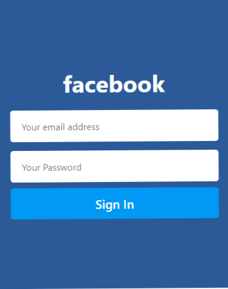
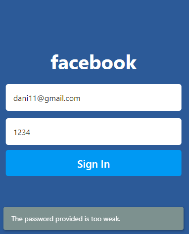

# Firebase SignIn Auth App

A Flutter project demonstrating user authentication using Firebase. This application includes a complete UI flow for user login, error handling for incorrect credentials, a splash screen, and a secure home dashboard upon successful authentication.

## 🖼️ Screenshots

<p align="center">
  
  
  
  
</p>

## 📱 Screens Included

This project includes the following core authentication views:

* **Splash View:** (`lib/SplashView/splash.dart`) - Initial app loading and routing screen.
* **Sign In View:** (`lib/SignInView/signin.dart`) - Authentication interface supporting login methods.
* **Home View:** (`lib/HomeView/home.dart`) - The main dashboard accessible only after successful login.

## 📂 Project Structure

```text
lib/
├── App-Pics/                # UI Reference Screenshots
├── HomeView/
│   └── home.dart            # Authenticated user dashboard
├── SignInView/
│   └── signin.dart          # Login and error handling UI
├── SplashView/
│   └── splash.dart          # Startup splash screen
├── firebase_options.dart    # Firebase configuration file
└── main.dart                # Application entry point
